# VMD-Tachyon Export — MoleditPy Plugin

Render the current MoleditPy molecule — and Gaussian cube data — with
your **local VMD installation** through the **Tachyon** ray-tracing
engine. Every render produces a publication-quality image **plus a
complete, editable VMD scene project**, so any picture can be tweaked
by hand in VMD and re-rendered without MoleditPy.

[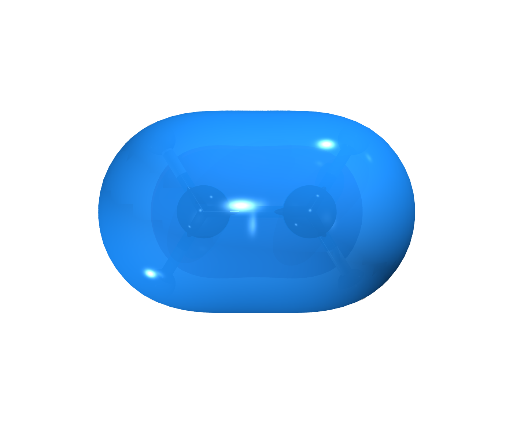](examples/01_orbitals/ethylene/render_homo.png)

*The HOMO of ethylene — the bonding π orbital — viewed from 45° above
the molecular plane. Rendered from an ORCA B3LYP/def2-SVP orbital cube
with this plugin's default High Quality preset. One of the six
reproducible examples in [`examples/`](examples/README.md).*

## Features

* **Three entry points**, exactly like the bundled exporters: the
  *Export 3D* toolbar button, *File → Export*, and *Plugins →
  VMD-Tachyon Export*.
* **Publication-quality rendering** through VMD's Tachyon engine
  (external renderer with exact resolutions, `-trans_raster3d
  -fullshade`, AA up to 32 samples) — verified against a real
  VMD 2.0.0 installation.
* **Exact chemistry**: atom order, elements and coordinates are
  exported 1:1 from the RDKit molecule, and connectivity goes into a
  PSF topology — VMD never re-guesses bonds by distance, which matters
  for radicals and transition states.
* **Isosurface maps**: two-lobe orbitals/spin (blue/red), MEP and any
  property mapped on a density surface (BWR color scale with
  percentile-based auto range), ELF localization domains, `.cub` /
  `.cube` / gzipped cubes — recognized by content, auto-associated
  when the molecule itself comes from a cube file.
* **Editable render projects**: each render leaves `scene.tcl`
  (portable, relative paths), a VMD state snapshot, re-render scripts,
  a manifest with full provenance and a README — reopen, restyle and
  re-render in VMD whenever you like.
* **Camera matching**: the PyVista/VTK camera of MoleditPy's 3D view
  is transferred exactly to VMD (verified to within 1 pixel).
* **Cross-platform VMD detection** (Linux, Windows, macOS) with a
  *Test VMD Installation* dialog that reports exactly which dependency
  is missing, with per-OS guidance.
* Native TGA deliverable by default (no re-encode); lossless PNG/TIFF
  conversion and transparent-background keying when requested.

## What you get

### Presets

From the tuned default to classic publication looks — one click, every
parameter still editable:

[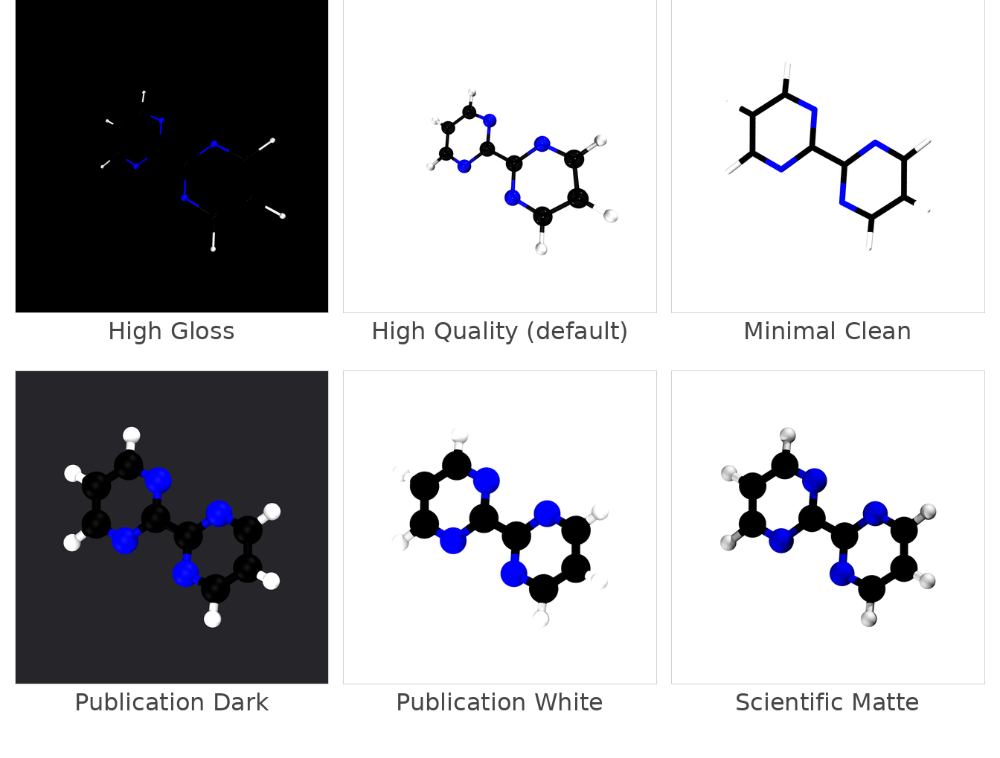](assets/banner_presets.png)

### Every VMD material

The same molecule through all 22 VMD materials, stock forms:

[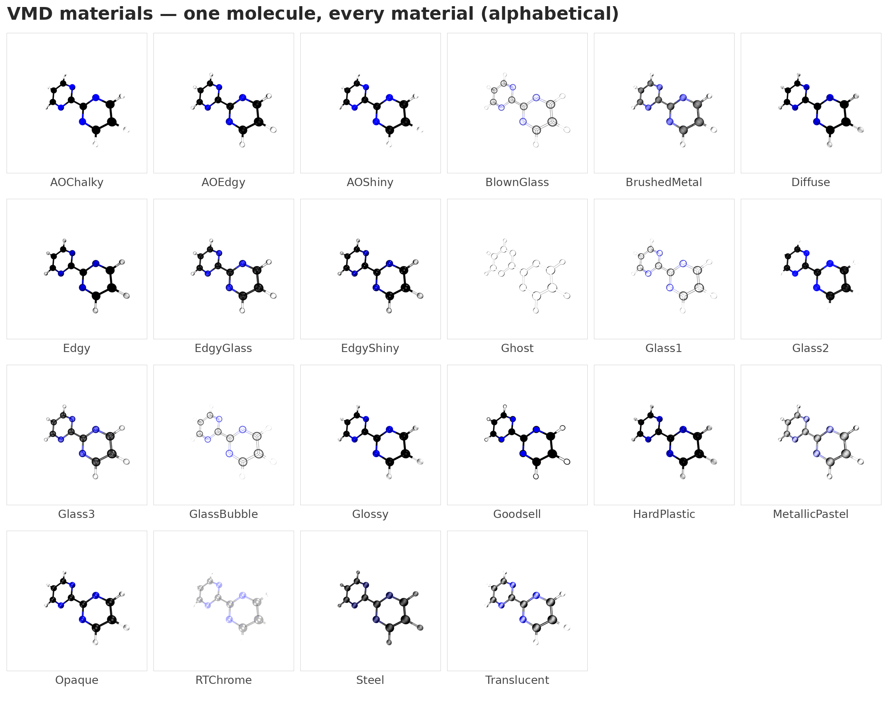](assets/banner_materials.png)(assets/banner_materials.png)

### Every representation

All styles on the Publication White preset:

[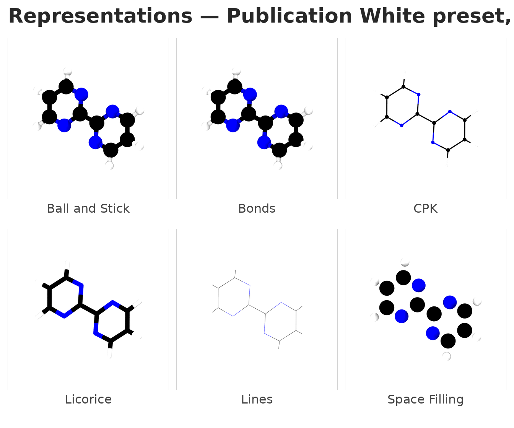](assets/banner_representations.png)

## Examples

Six complete, reproducible workflows live in
[`examples/`](examples/README.md) — each with the ORCA input
(B3LYP/def2-SVP, seconds per molecule), outputs, cubes, rendered
images and a step-by-step guide.

**[🖼️ View the complete gallery →](examples/README.md)** — every image
below opens at full render resolution (1400 × 1160) when clicked.

| Example | Render (click to view full size) | Guide |
|---|---|---|
| Ethylene — HOMO π | [](examples/01_orbitals/ethylene/render_homo.png) | [step by step](examples/01_orbitals/ethylene/README.md) |
| Ethylene — LUMO π* | [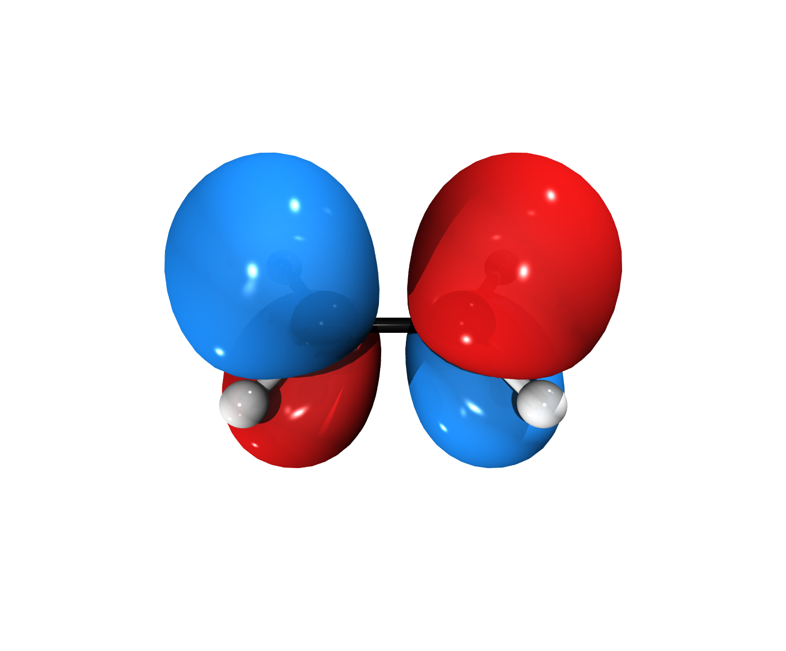](examples/01_orbitals/ethylene/render_lumo.png) | [step by step](examples/01_orbitals/ethylene/README.md) |
| Formaldehyde — HOMO n(O) | [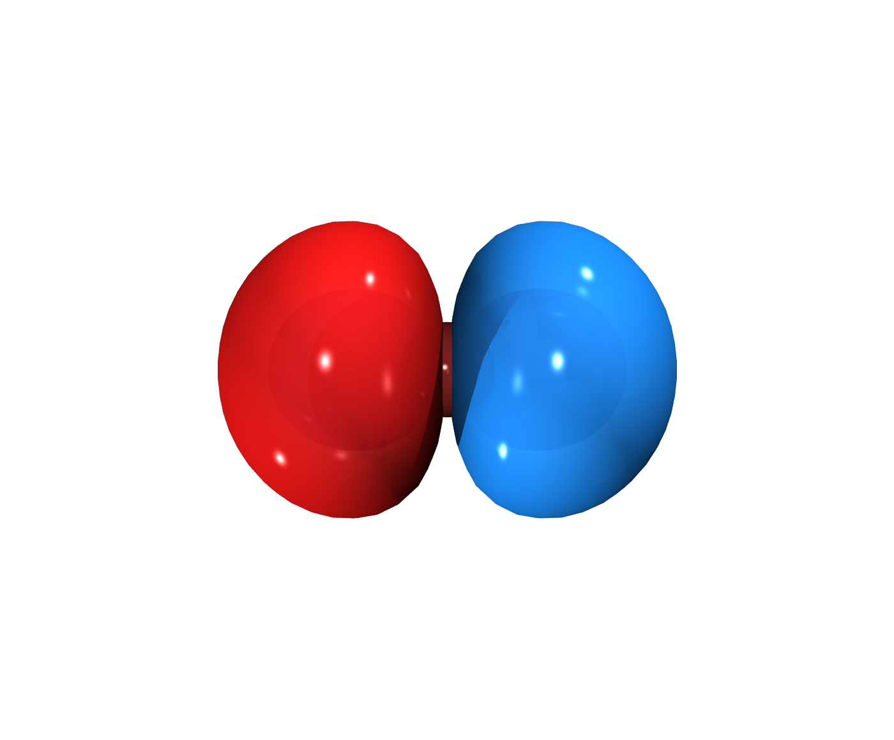](examples/01_orbitals/formaldehyde/render_homo.png) | [step by step](examples/01_orbitals/formaldehyde/README.md) |
| Formaldehyde — LUMO π*(C=O) | [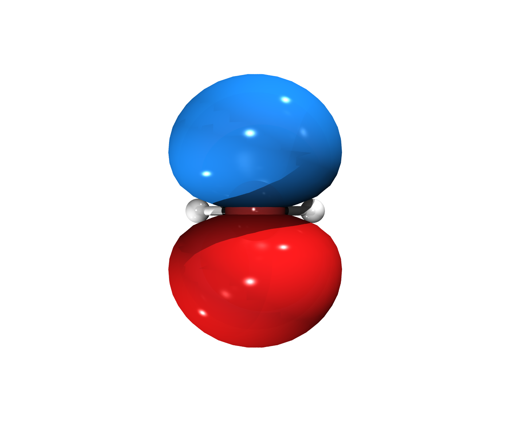](examples/01_orbitals/formaldehyde/render_lumo.png) | [step by step](examples/01_orbitals/formaldehyde/README.md) |
| Water — MEP on density surface | [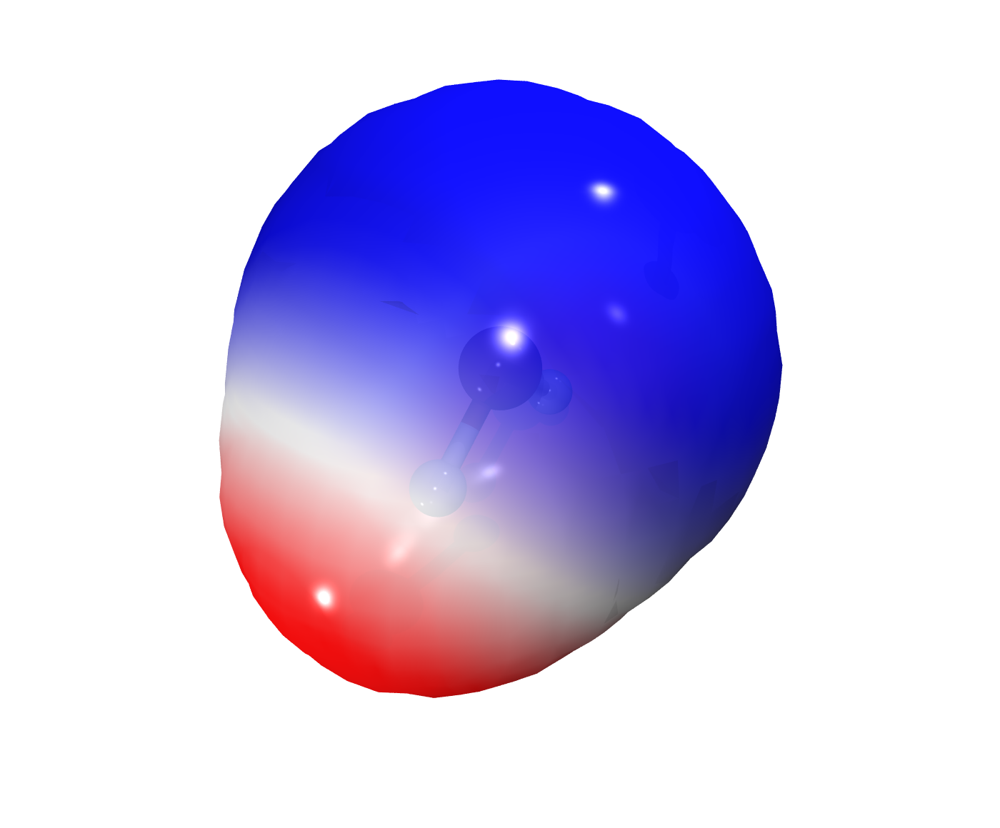](examples/02_mep/water/render_mep.png) | [step by step](examples/02_mep/water/README.md) |
| Chloromethane — MEP, chlorine pocket | [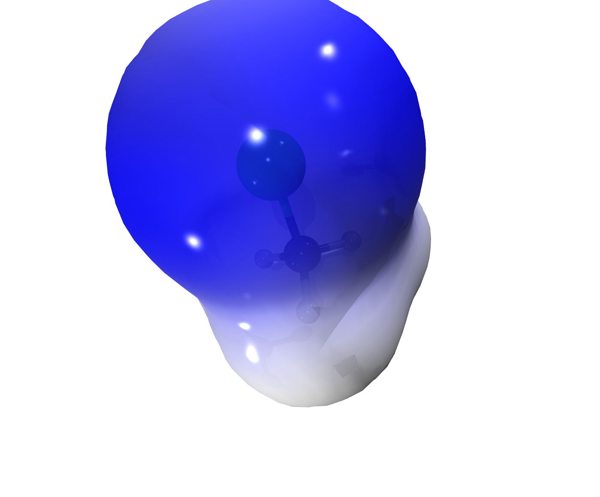](examples/02_mep/chloromethane/render_mep.png) | [step by step](examples/02_mep/chloromethane/README.md) |
| Methyl radical — spin density | [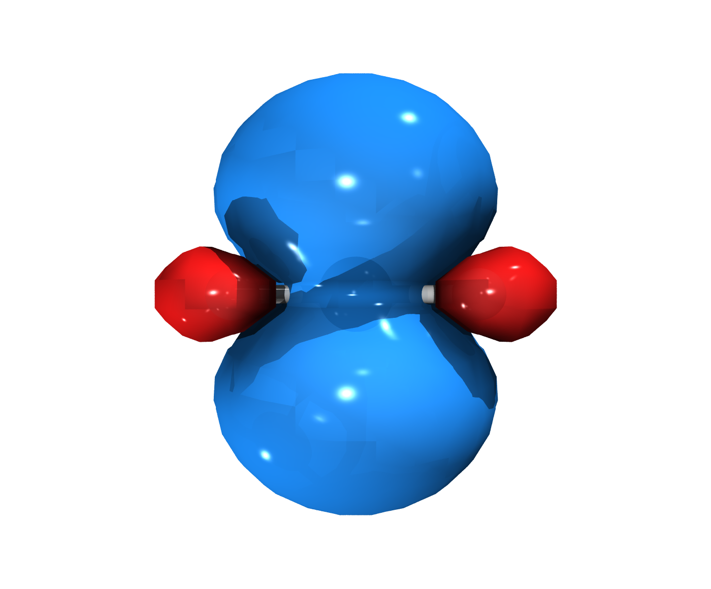](examples/03_spin_elf/methyl_radical/render_spin.png) | [step by step](examples/03_spin_elf/methyl_radical/README.md) |
| Water — ELF localization domains | [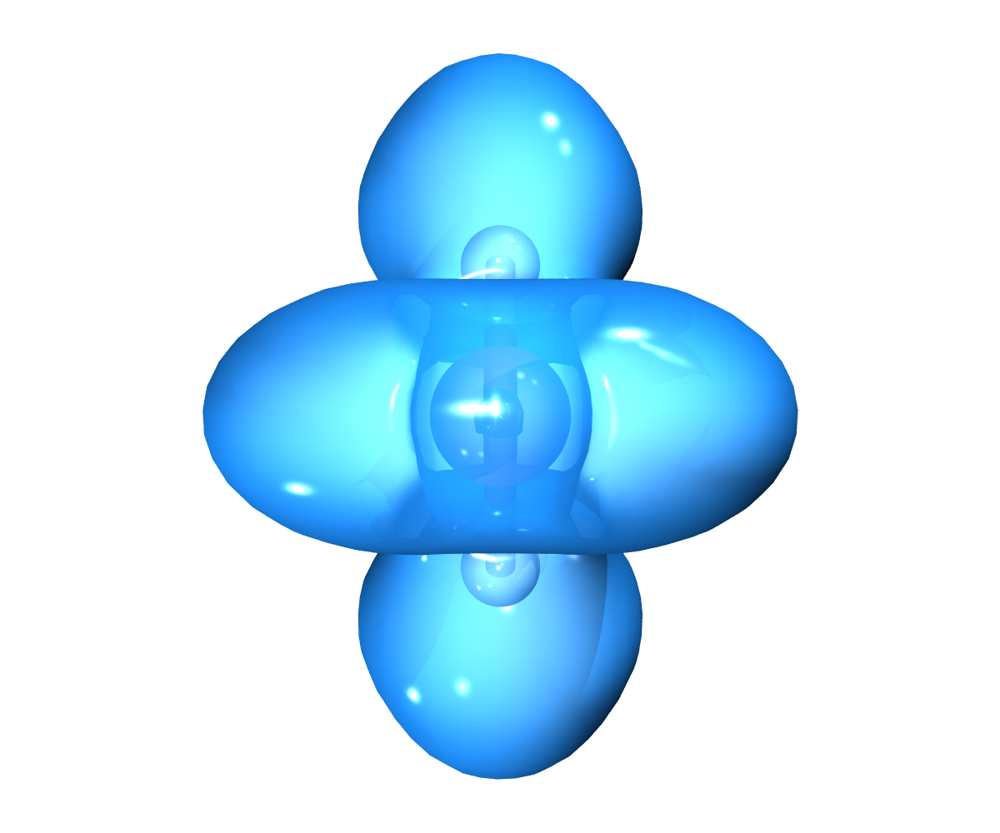](examples/03_spin_elf/water_elf/render_elf.png) | [step by step](examples/03_spin_elf/water_elf/README.md) |

Also inside: the [quickstart](examples/00_quickstart/README.md)
(open a cube → image in one click) and a generator script that re-runs
the whole gallery.

## Requirements

* MoleditPy **5.x** (PySide6, numpy and RDKit ship with it).
* A local **VMD** installation (verified with VMD 2.0.0 on Linux).
  VMD is *not* installed or modified by the plugin — it is detected
  (env vars, PATH and the usual per-OS locations), validated in text
  mode and used as an external rendering backend.
* Optional: Pillow (TIFF output; TGA/PNG need nothing extra), ORCA +
  Multiwfn only for the examples.

## Installation

Manual installation:

1. Download `VMD-tachyon_export.py`.
2. Place it in the MoleditPy plugins folder
   (`~/.moleditpy/plugins/` on Linux/macOS,
   `%USERPROFILE%\.moleditpy\plugins\` on Windows).
3. Restart MoleditPy.

The plugin may also become available through MoleditPy's official
Plugin Installer if accepted into its plugin registry.

## Usage

1. Load a molecule (3D coordinates) — or simply open a `.cub`/`.cube`
   file: the plugin auto-detects it as volumetric data.
2. Open the dialog from the *Export 3D* button, *File → Export* or
   *Plugins → VMD-Tachyon Export*.
3. Check the detected VMD installation (or press *Test VMD
   Installation*), pick a preset and press **Render**.
4. The results panel shows the image and the project folder with
   *Open Image*, *Open Output Folder*, *Open Scene in VMD*,
   *Re-render* and *Re-render edited scene*.

The GUI never blocks: VMD and Tachyon run as separate processes with
full logging. Every parameter — isovalue, colors, materials, lights,
camera, resolution — is editable and remembered between sessions.

## Limitations

* The built-in TachyonInternal engine rounds resolutions to multiples
  of 16 (VMD behaviour); exact resolutions use the external renderer.
* This VMD/Tachyon build writes no alpha channel or PNG/TIFF:
  transparency is a documented post-process and conversions are
  lossless.
* `scene.vmd` snapshots store absolute paths (VMD behaviour), so they
  are machine-local; `scene.tcl` is the portable reconstruction.
* VMD's cube loader replaces coordinates with those embedded in the
  cube (identical when both come from the same geometry).

See the README inside any render project for the full list.

## Development

```bash
python -m pytest tests/test_vmd_tachyon_export.py   # unit tests
python tests/e2e_real_vmd.py                        # end-to-end with VMD
python assets/generate_banners.py                   # regenerate the banners
python examples/generate_examples.py                # regenerate the gallery
```

## Compatibility

* MoleditPy `>=5.0.0, <6.0.0` · Python 3 (3.10+ recommended).
* Verified end-to-end on Linux (CachyOS/Arch, VMD 2.0.0); Windows and
  macOS detection follows VMD's documented layouts (best effort,
  reported clearly by the diagnostics dialog).

## Version

**2026.11.07** — see
[CHANGELOG.md](CHANGELOG.md).

## Author

**borisiori** — [github.com/borisiori](https://github.com/borisiori)

## License

GNU Lesser General Public License v3.0 or later
(LGPL-3.0-or-later) — the same license as MoleditPy. See
[LICENSE](LICENSE) and [COPYING](COPYING).

## References

If you use these tools in your research, please cite the original
works:

* **MoleditPy**: H. Yokoyama, *MoleditPy — A Python-based molecular
  editing software*, DOI: [10.5281/zenodo.17268532](https://doi.org/10.5281/zenodo.17268532)
* **VMD**: W. Humphrey, A. Dalke and K. Schulten, "VMD — Visual
  Molecular Dynamics", *J. Mol. Graphics* **1996**, *14*, 33–38.
  DOI: [10.1016/0263-7855(96)00018-5](https://doi.org/10.1016/0263-7855(96)00018-5)
* **ORCA** (used in the examples): F. Neese, "Software update: the ORCA
  program system, version 5.0", *WIREs Comput. Mol. Sci.* **2022**, *12*,
  e1606. DOI: [10.1002/wcms.1606](https://doi.org/10.1002/wcms.1606)
* **Multiwfn** (used in the examples): T. Lu and F. Chen, "Multifunctional
  wavefunction analyzer", *J. Comput. Chem.* **2012**, *33*, 580–592.
  DOI: [10.1002/jcc.22885](https://doi.org/10.1002/jcc.22885)

## Acknowledgments

Built for [MoleditPy](https://github.com/HiroYokoyama/MoleditPy) by
Hiromichi Yokoyama, using [VMD](https://www.ks.uiuc.edu/Research/vmd/)
and its Tachyon renderer by John E. Stone and co-workers, with cube
tooling from ORCA (Max-Planck-Institut für Kohlenforschung) and
[Multiwfn](https://sobereva.com/multiwfn) by Tian Lu in the examples.
