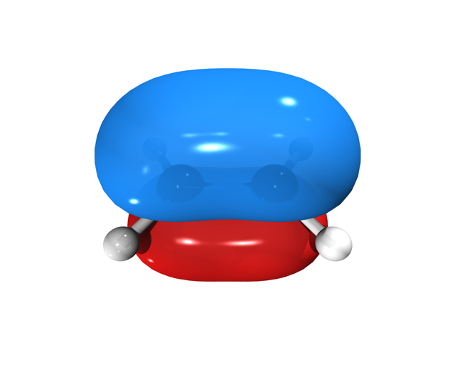

# Quickstart — open a cube, get an image

This is the fastest possible workflow: **one click** from a cube file to
a rendered image with an editable VMD scene project.

## What happened

1. The orbital cube `homo.cube` (ethylene HOMO, from the ORCA B3LYP
   example) was opened in MoleditPy (**File → Open**).
2. The plugin detected that the opened file **is itself volumetric
   data** and auto-enabled the isosurface — no extra configuration:

   ```
   [cube] auto-associated from the loaded file: homo.cube
          (same system — isosurface enabled)
   ```

3. **Render** with the default High Quality preset produced the image
   below and a complete, editable VMD scene project.



## Folder contents

```
00_quickstart/
├── README.md                    this file
├── render_preview.png           the resulting image
├── inputs/
│   └── homo.cube                the orbital cube (also in 01_orbitals/)
└── VMD_Renders/molecule_001/    the full editable render project
    ├── geometry/                exact PSF topology + PDB + XYZ
    ├── scene/scene.tcl          THE editable scene (relative paths)
    ├── scene/scene.vmd          VMD state snapshot
    ├── scene/render.tcl         re-render without MoleditPy
    ├── scene/render_edited.tcl  re-render after editing in the VMD GUI
    ├── output/                  final images
    ├── logs/                    full process transcript
    ├── manifest.json            provenance: versions, engine, parameters
    └── README.md                how to reopen, edit and re-render
```

## Reproduce it

1. Open MoleditPy
2. **File → Open** → select `inputs/homo.cube`
3. **Plugins → VMD-Tachyon Export** (or the Export 3D button)
4. Press **Render** — done

## Re-render without MoleditPy

```bash
cd VMD_Renders/molecule_001
vmd -dispdev none -e scene/render.tcl
<your-tachyon-path> tachyon/scene.dat -o output/render.tga \
    -res 1400 1160 -aasamples 24 -trans_raster3d -fullshade
```
