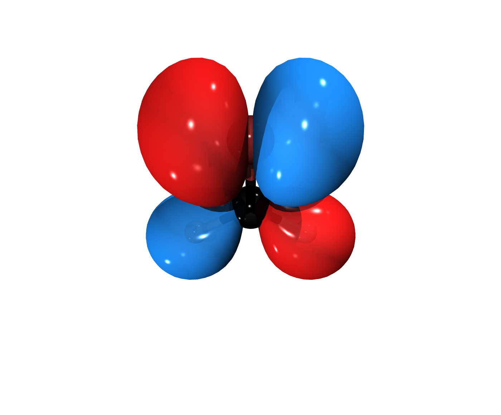

# Formaldehyde — HOMO n(O) and LUMO π*(C=O)

The classic donor–acceptor pair: the HOMO is the n lone pair on oxygen (in the molecular plane) and the LUMO the π* of the carbonyl group. Isovalue ±0.05, viewed from 45° above.



## Folder contents

* `formaldehyde.inp` / `.out` / `.gbw`
* `homo.cube` (n), `lumo.cube` (π*)
* `render_homo.png`, `render_lumo.png` + editable
  `VMD_Renders/` scene projects

## Step-by-step reproduction guide

### 1 · ORCA calculation (B3LYP/def2-SVP, geometry optimization)

```bash
orca formaldehyde.inp > formaldehyde.out
```

### 2 · Extract the cube
The HOMO of this molecule is orbital `NO = 7` in the ORBITAL
ENERGIES table (ORCA convention); the LUMO is `NO = 8`:

```bash
# HOMO
printf "2\n7\n4\n80 80 80\n11\n12\n" | orca_plot formaldehyde.gbw -i
mv formaldehyde.mo7a.cube homo.cube
# LUMO
printf "2\n8\n4\n80 80 80\n11\n12\n" | orca_plot formaldehyde.gbw -i
mv formaldehyde.mo8a.cube lumo.cube
```

(menu: 2 = orbital number · 4 = grid 80³ · 11 = generate · 12 = exit)


### 3 · Render with the VMD-Tachyon Export plugin

1. Open MoleditPy and load the geometry or the cube file
   (**File → Open** `homo.cube` (isosurface auto-enabled)).
2. **Plugins → VMD-Tachyon Export** (or the *Export 3D* button).
3. In the **Volumetric** tab: set *Isovalue* to ±0.05; then repeat with `lumo.cube`
4. **Render** → image in `VMD_Renders/molecule_00X/output/`.
   Each render also produces an editable scene (`scene/scene.tcl`,
   `scene.vmd`) for further tweaking in VMD.

### Quick alternative

```bash
<moleditpy-venv>/bin/python examples/generate_examples.py
```
> **Orbital numbering**: ORCA (and its `orca_plot` tool) number orbitals
> **from 0** — the HOMO of a closed-shell molecule with 2N electrons
> appears as `NO = N-1` in the ORBITAL ENERGIES table of the `.out`
> file. Multiwfn, in contrast, uses 1-based numbering on the molden
> file. With `orca_plot`, use the number exactly as printed in the
> ORCA table.