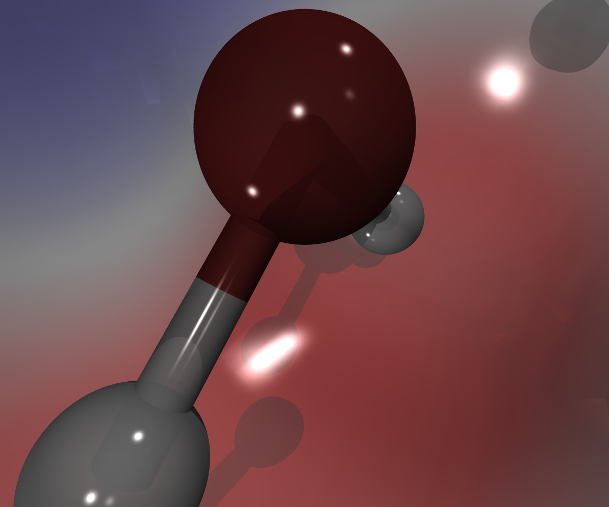

# Agua — potencial electrostático (MEP)

MEP mapeado sobre la superficie de densidad electrónica ρ = 0.001 a.u. (superficie vdW): azul = negativo alrededor del oxígeno, rojo = positivo sobre los hidrógenos. Escala BWR simétrica ±0.04 a.u.



## Contenido de la carpeta

* `water.inp` / `.out` / `.gbw`
* `density.cube` (orca_plot) + `esp.cube` (Multiwfn)
* `render_mep.png` + proyecto `VMD_Renders/`

## Paso a paso para reproducir la visualización

### 1 · Cálculo ORCA (B3LYP/def2-SVP, optimización)

```bash
orca water.inp > water.out
```

### 2 · Extraer el cube
```bash
# cube de densidad (la "forma" de la superficie)
printf "1\n2\n4\n80 80 80\n11\n12\n" | orca_plot water.gbw -i
mv water.eldens.cube density.cube
# molden → ESP con Multiwfn (función 12, grid medio, exportar cube)
orca_2mkl water -molden
printf "5\n12\n2\n2\n0\nq\n" | Multiwfn water.molden.input
mv totesp.cub esp.cube
```


### 3 · Renderizar con el plugin VMD-Tachyon Export

1. Abre MoleditPy y carga la geometría o el cube
   (**Archivo → Abrir** `density.cube` (activa la isosuperficie)).
2. **Plugins → VMD-Tachyon Export** (o el botón *Export 3D*).
3. En la pestaña **Volumetric**: *Isovalue +* **0.001**; en **Property Map → Load Map…** elige `esp.cube`, *Scale min/max* **−0.04 / 0.04**, *Colormap* **BWR**
4. **Render** → imagen en `VMD_Renders/molecule_00X/output/`.
   Cada render deja además la escena editable (`scene/scene.tcl`,
   `scene.vmd`) para retocarla en VMD y volver a renderizar.

### Alternativa: un solo comando

```bash
<moleditpy-venv>/bin/python examples/generate_examples.py
```
