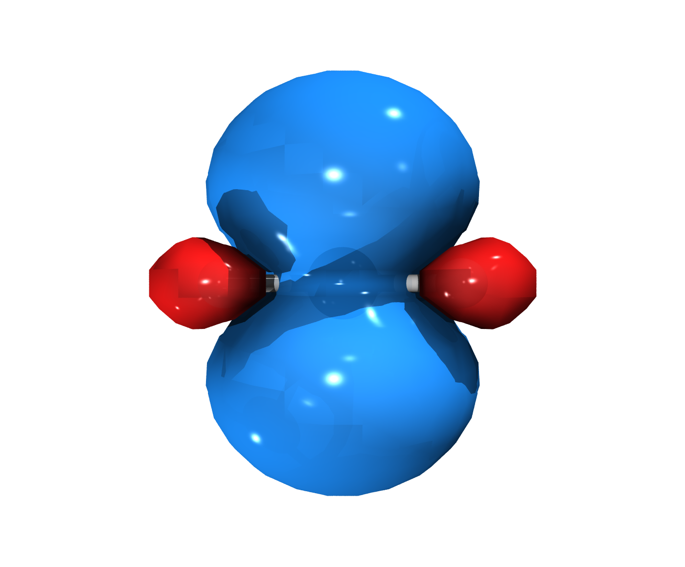

# Methyl radical — spin density

Unrestricted calculation (UKS, multiplicity 2): all the spin density is α — the two blue domes above and below the planar CH₃ framework correspond to the singly occupied p orbital on the radical carbon. Isovalue ±0.002, viewed edge-on to show both lobes.



## Folder contents

* `methyl_radical.inp` (`UKS`, mult 2) / `.out` /
  `.gbw`
* `spindens.cube`
* `render_spin.png` + editable `VMD_Renders/` project

## Step-by-step reproduction guide

### 1 · ORCA calculation (B3LYP/def2-SVP, geometry optimization)

```bash
orca methyl_radical.inp > methyl_radical.out
```

### 2 · Extract the cube
```bash
printf "1\n3\n4\n80 80 80\n11\n12\n" | orca_plot methyl_radical.gbw -i
mv methyl_radical.spindens.cube spindens.cube
```

(menu: 1 = plot type → 3 = SCF spin density)


### 3 · Render with the VMD-Tachyon Export plugin

1. Open MoleditPy and load the geometry or the cube file
   (**File → Open** `spindens.cube` (isosurface auto-enabled)).
2. **Plugins → VMD-Tachyon Export** (or the *Export 3D* button).
3. In the **Volumetric** tab: set *Isovalue* to ±0.002; only the blue (α) dome appears
4. **Render** → image in `VMD_Renders/molecule_00X/output/`.
   Each render also produces an editable scene (`scene/scene.tcl`,
   `scene.vmd`) for further tweaking in VMD.

### Quick alternative

```bash
<moleditpy-venv>/bin/python examples/generate_examples.py
```
