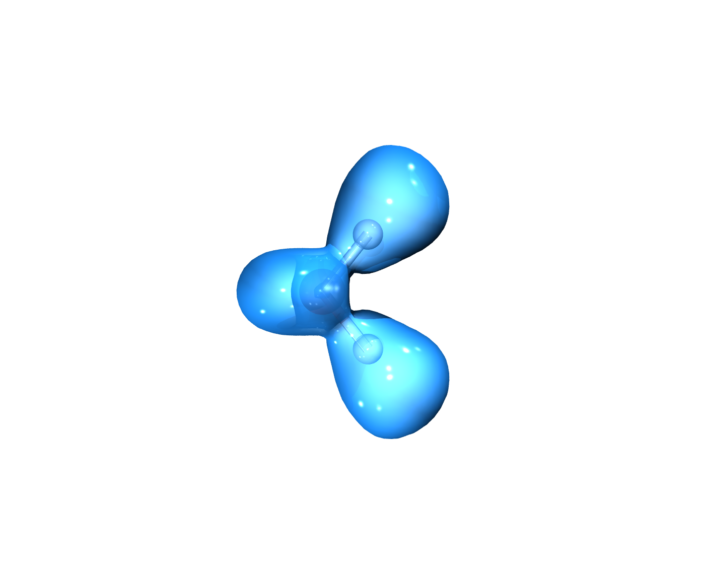

# Water — electron localization function (ELF) domains

Translucent ELF = 0.8 isosurface (opacity 0.55): the localization domains isolate the two oxygen lone pairs, the O–H bonds and the hydrogen atoms as independent regions. ELF computed with Multiwfn (function 9), viewed perpendicular to the molecular plane.



## Folder contents

* `water.inp` / `.out` / `.gbw`
* `elf.cube` (Multiwfn)
* `render_elf.png` + editable `VMD_Renders/` project

## Step-by-step reproduction guide

### 1 · ORCA calculation (B3LYP/def2-SVP, geometry optimization)

```bash
orca water.inp > water.out
```

### 2 · Extract the cube
```bash
orca_2mkl water -molden
printf "5\n9\n2\n2\n0\nq\n" | Multiwfn water.molden.input
mv elf.cub elf.cube      # ELF (function 9), medium grid
```


### 3 · Render with the VMD-Tachyon Export plugin

1. Open MoleditPy and load the geometry or the cube file
   (**File → Open** `elf.cube` (isosurface auto-enabled)).
2. **Plugins → VMD-Tachyon Export** (or the *Export 3D* button).
3. In the **Volumetric** tab: *Isovalue +* **0.8** and *Opacity* **0.55** to see the
     molecule inside the domains
4. **Render** → image in `VMD_Renders/molecule_00X/output/`.
   Each render also produces an editable scene (`scene/scene.tcl`,
   `scene.vmd`) for further tweaking in VMD.

### Quick alternative

```bash
<moleditpy-venv>/bin/python examples/generate_examples.py
```
