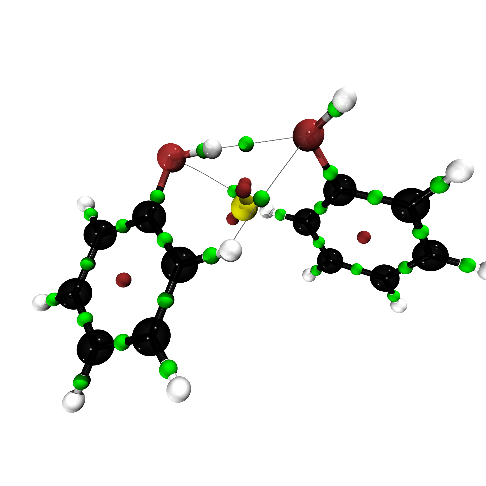

# QTAIM — Phenol Dimer

Atoms-in-molecules analysis of a phenol dimer: bond critical points
(green), ring critical points (red) and bond paths (gray lines).

## Files

- `CPs.pdb` — critical points (N=BCP, O=RCP, F=CCP)
- `paths.pdb` — bond paths (gradient trajectories)
- `PhenolDimer.xyz` — molecular geometry
- `render.png` — the result

## Reproduce

1. Open `PhenolDimer.xyz` in MoleditPy
2. QTAIM tab → **CPs…** → `CPs.pdb`
3. QTAIM tab → **Paths…** → `paths.pdb`
4. Render
