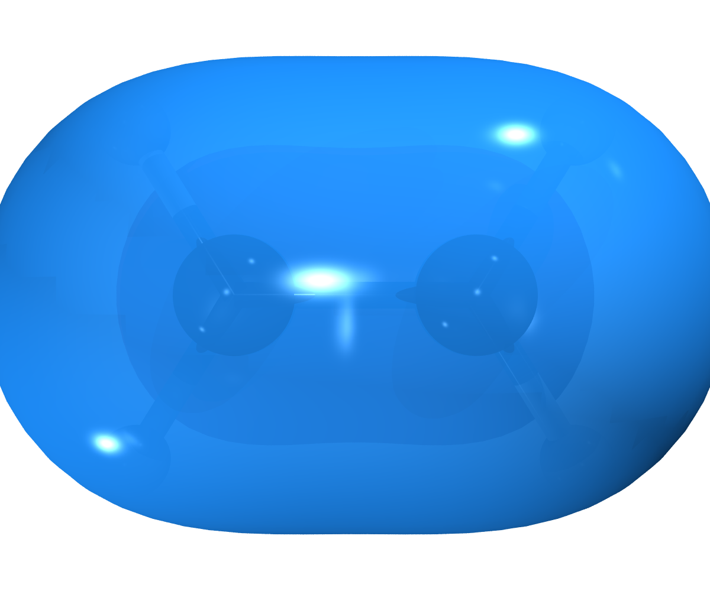
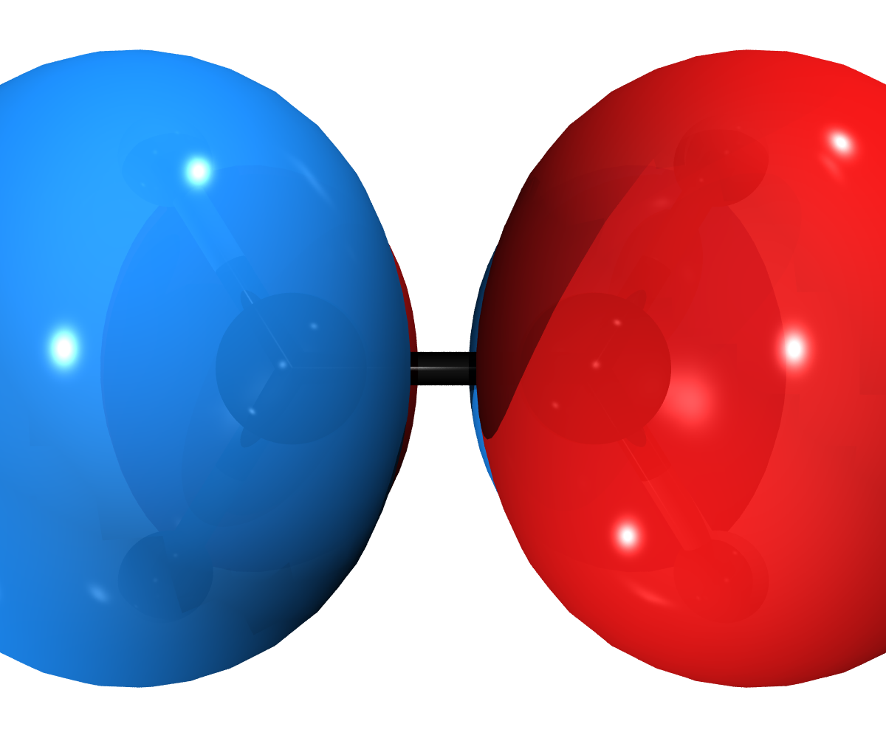
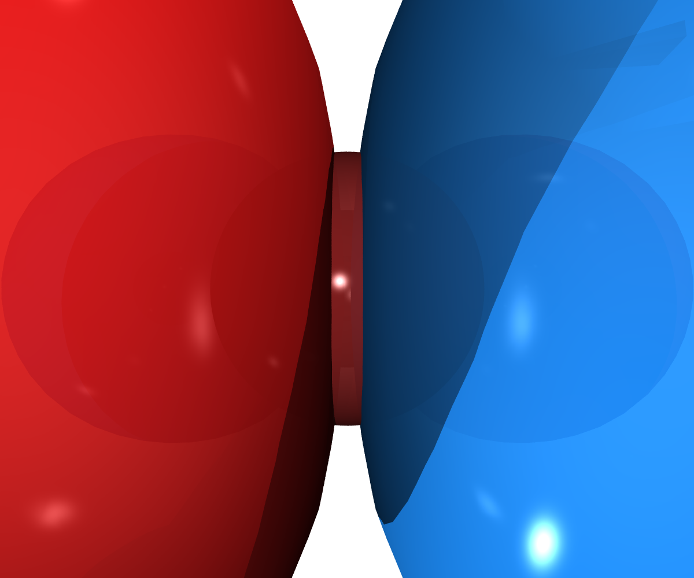
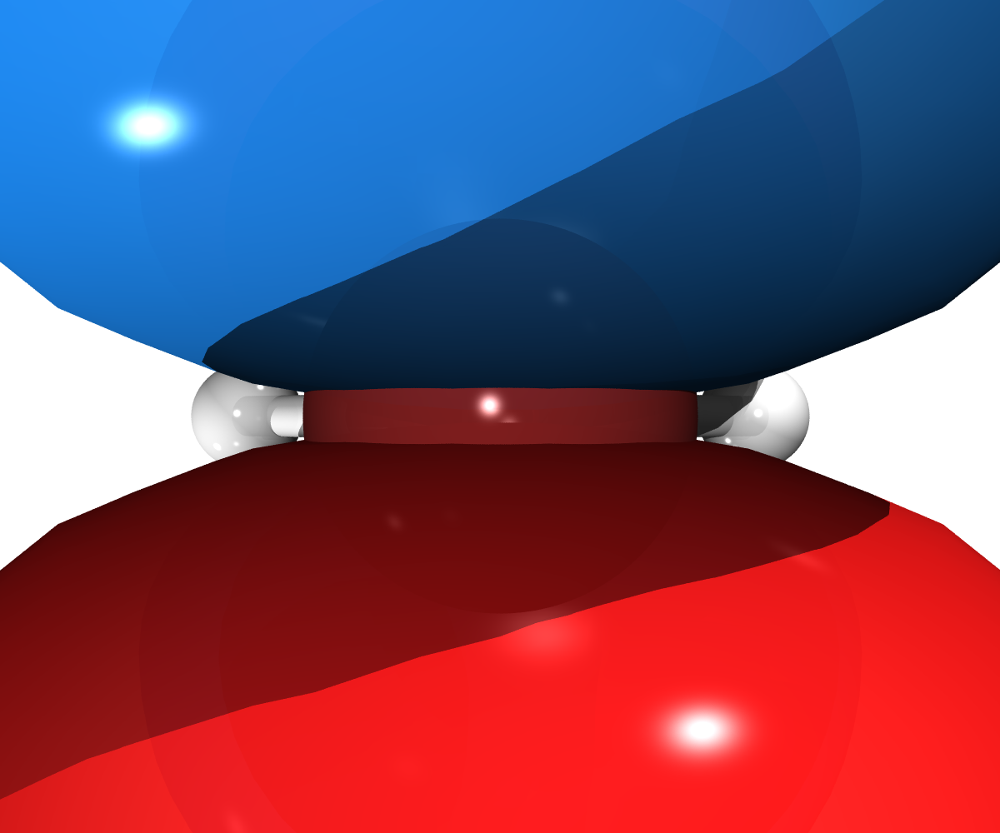
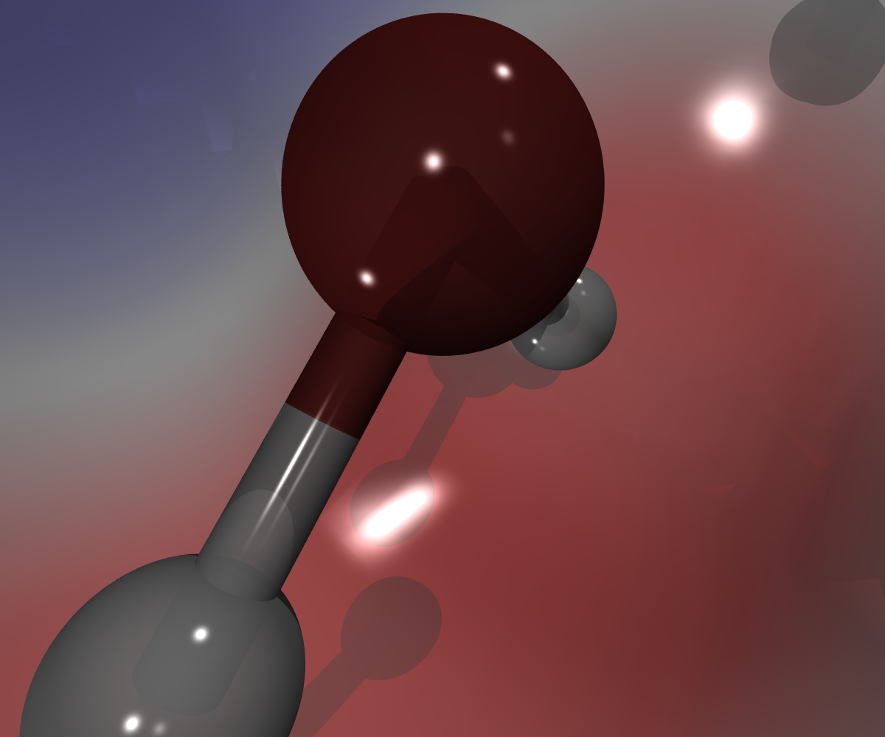
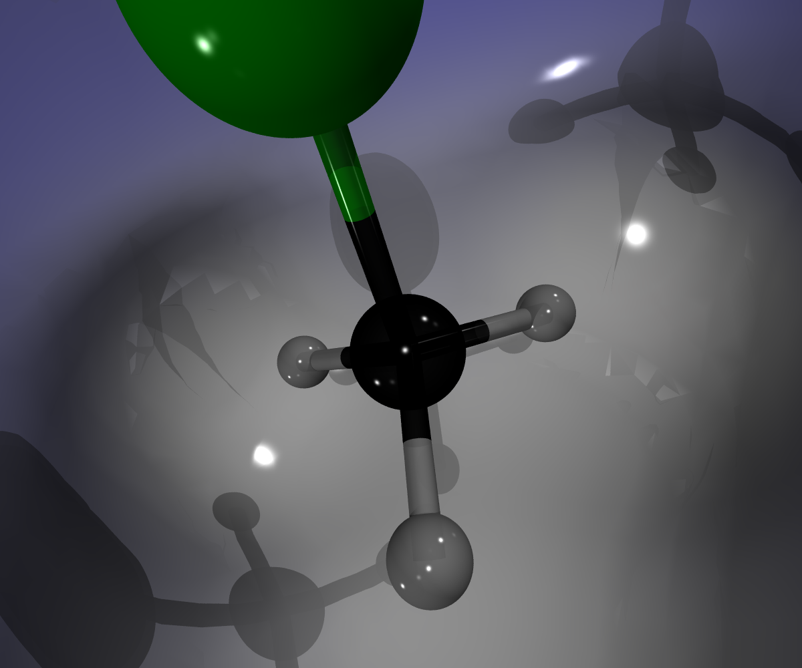
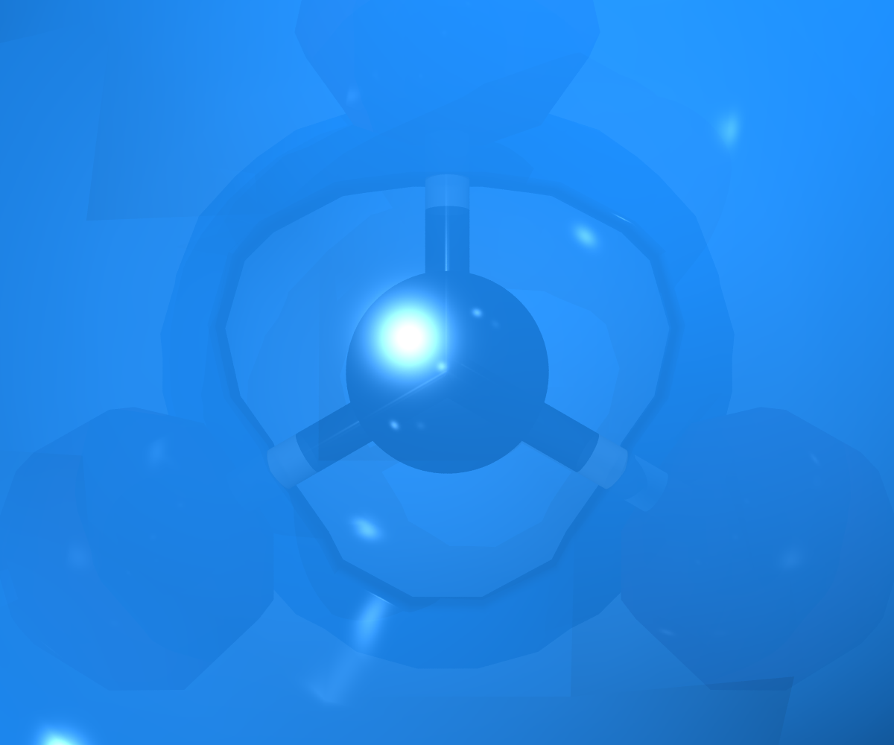
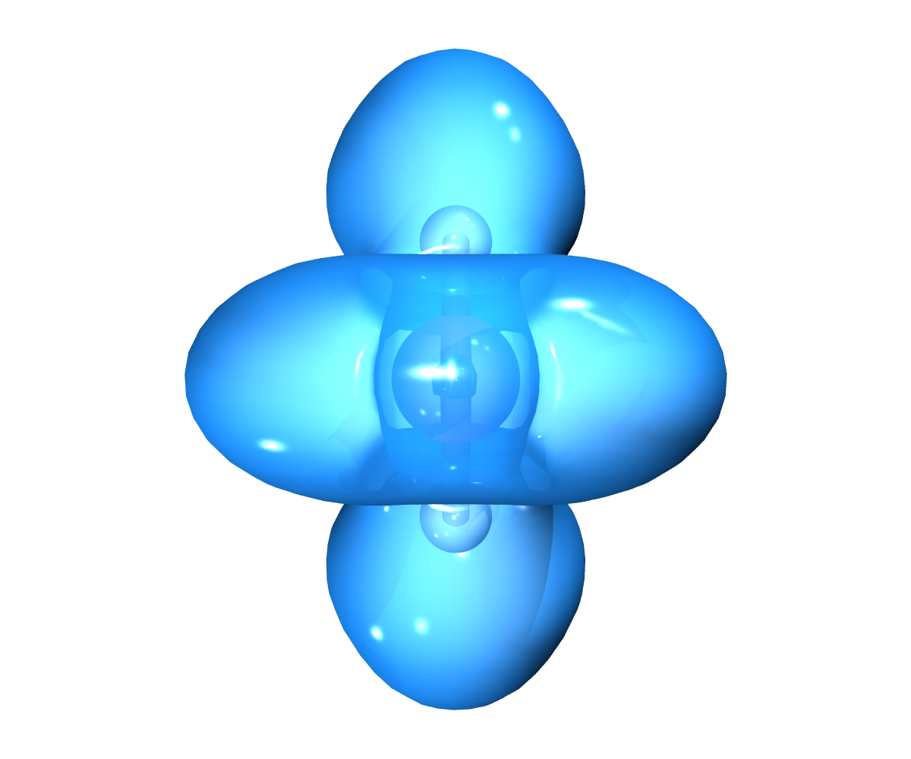

# Examples gallery

Six ready-to-run examples (ORCA B3LYP/def2-SVP, seconds per molecule)
showing the isosurface map types the plugin renders. Every folder keeps
the full chain — `.inp`, `.out`, `.gbw`, the cubes and the rendered
image plus its editable VMD scene project — so anyone can reproduce or
tweak the pictures.

Reproduce everything with one command (needs ORCA, Multiwfn and VMD on
PATH, see `generate_examples.py`):

```bash
<moleditpy-venv>/bin/python examples/generate_examples.py
```

## 1 · Molecular orbitals (HOMO / LUMO)

Positive lobe blue, negative lobe red, isovalue ±0.05. Cubes extracted
with ORCA's own `orca_plot` tool.

### Ethylene — the textbook π / π* pair ([step by step](01_orbitals/ethylene/README.md))

| HOMO (π) | LUMO (π*) |
|---|---|
|  |  |

### Formaldehyde — n(O) donor vs π*(C=O) acceptor ([step by step](01_orbitals/formaldehyde/README.md))

| HOMO (n, lone pair on O) | LUMO (π*) |
|---|---|
|  |  |

## 2 · Molecular electrostatic potential (MEP)

Electrostatic potential mapped on the 0.001 a.u. electron-density
surface (blue-white-red). Density cube from `orca_plot`; ESP cube from
**Multiwfn** (function 12) over the ORCA molden file.

### Water — negative oxygen, positive hydrogens ([step by step](02_mep/water/README.md))



### Chloromethane — the chlorine pocket ([step by step](02_mep/chloromethane/README.md))



## 3 · Spin density & electron localization

### Methyl radical — spin density (α, UKS calculation) ([step by step](03_spin_elf/methyl_radical/README.md))



### Water — ELF = 0.8 localization domains (Multiwfn, function 9) ([step by step](03_spin_elf/water_elf/README.md))

The translucent domains isolate the two oxygen lone pairs, the O–H
bonds and the hydrogens.



## How each piece was produced

| Artifact | Command |
|---|---|
| Calculation | `orca <name>.inp > <name>.out` (geometry optimization, B3LYP/def2-SVP) |
| MO cube | `orca_plot <name>.gbw -i` → type 1 (MO), orbital number, grid 80³ |
| Density / spin cube | `orca_plot` → type 2 / 3 |
| molden file | `orca_2mkl <name> -molden` |
| ESP cube | `Multiwfn <name>.molden.input` → 5 (grid data) → 12 (ESP) → medium grid → export cube |
| ELF cube | same route, function 9 |
| Render | the VMD-Tachyon Export plugin (each folder has its full `VMD_Renders/` scene project) |

Notes:

* The scene projects were pruned for repository size (duplicated cube
  copies, 15 MB Tachyon dumps and native .tga removed — a lossless .png
  stays). To re-render a project standalone, first copy the top-level
  cubes of that example into `VMD_Renders/molecule_00X/volumetric/`.
* The `.gbw` files are kept on purpose: with `orca_plot` you can export
  ANY molecular orbital of these molecules without recalculating.
